# Supplier Portal – System Workflow

Mermaid diagrams derived from the code in `web/src` (routes in `lib/routes.ts`, onboarding rules in `lib/onboarding.ts`, sample-request rules in `lib/policy.ts`). The prototype stores all data in the browser (no backend), so "Procurement" and "Buyer" actions are simulated by the demo tools.

## 1. System overview

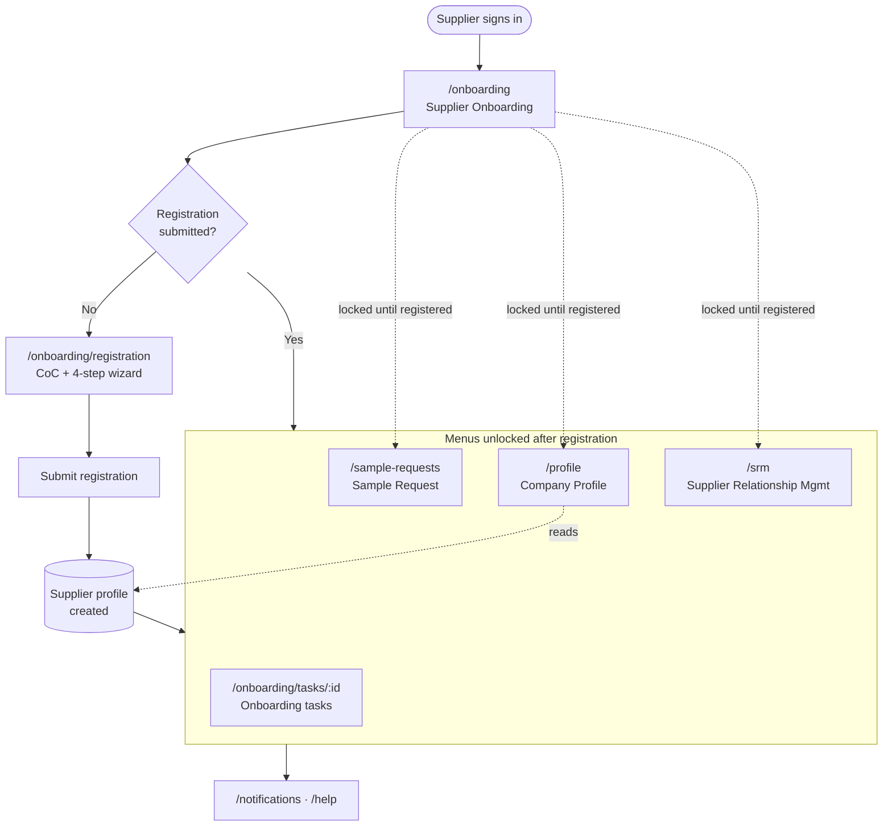

## 2. Onboarding stages (dashboard stepper)

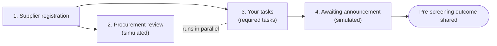

## 3. Supplier registration

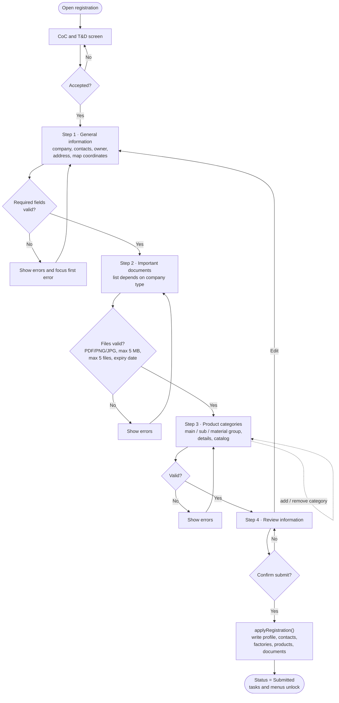

## 4. Onboarding tasks (gating rules)

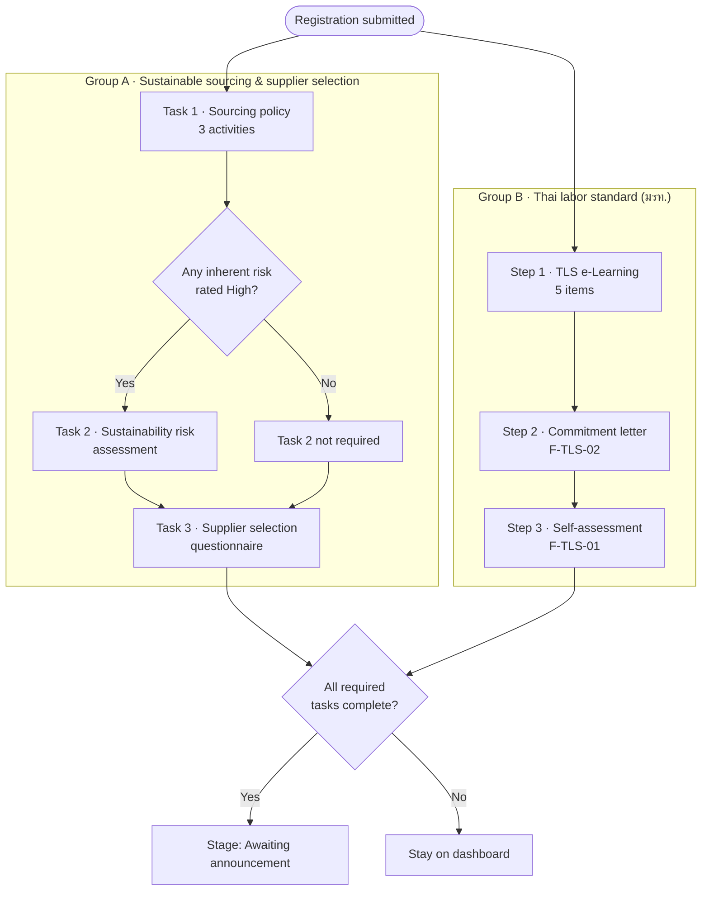

Group A and Group B are independent of each other; inside each group the next step stays locked until the previous one is complete.

### 4.1 Task 1 – Sourcing policy

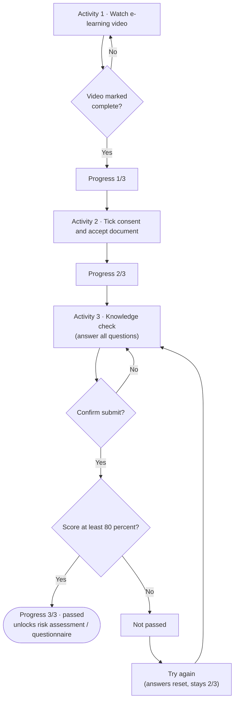

### 4.2 Task 2 – Sustainability risk assessment

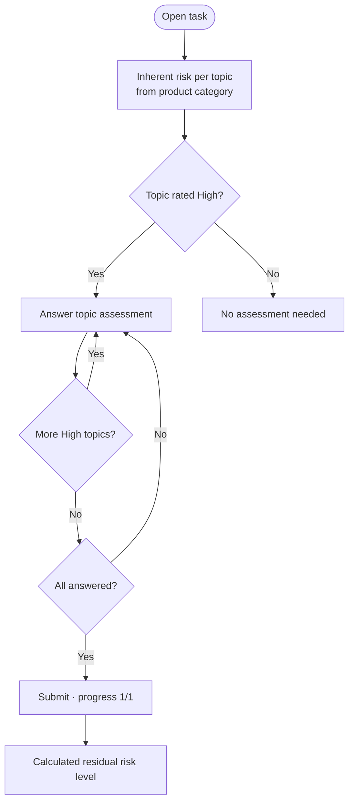

### 4.3 Task 3 – Supplier selection questionnaire

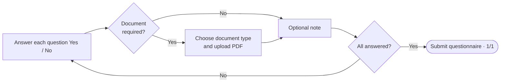

### 4.4 Thai labor standard (มรท.)

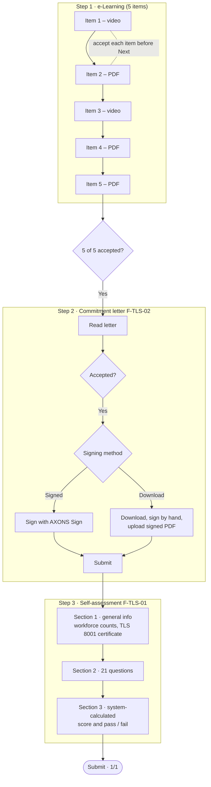

## 5. Sample request

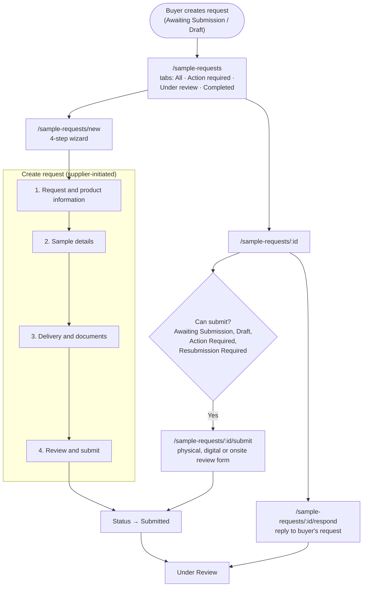

### 5.1 Sample request status lifecycle

Transitions are enforced by `transition()` in `lib/policy.ts`.

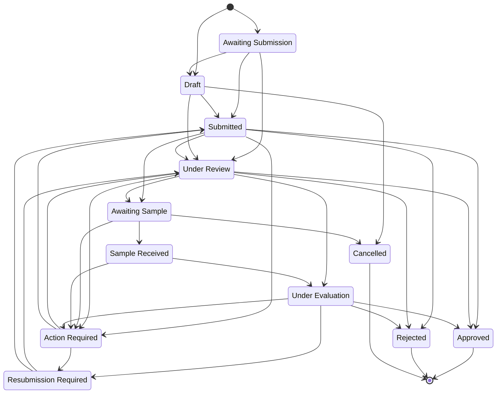

## 6. Company Profile and SRM

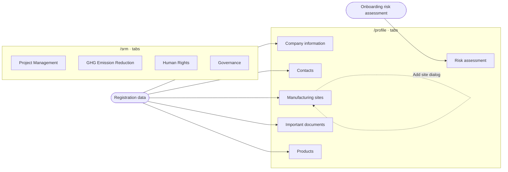

## 7. Data and state (prototype)

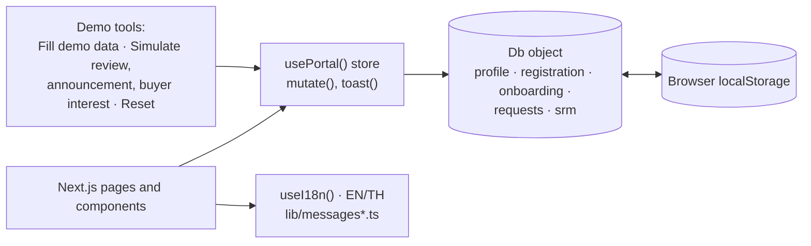
